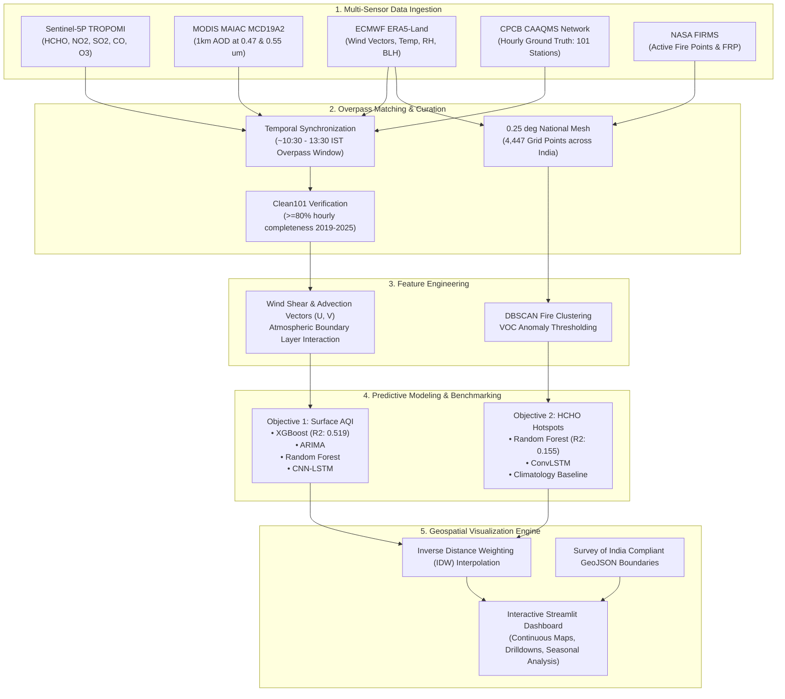

# VayuDrishti (वायुदृष्टि) — Satellite-Based Surface AQI & HCHO Hotspot Prediction

<div align="center">

[](https://www.isro.gov.in)
[](#-hackathon-recognition)
[](https://python.org)
[](https://pytorch.org)
[](https://streamlit.io)
[](https://earthengine.google.com)

**Bridging India's Air Quality Monitoring Gap Using Multi-Constellation Satellite Earth Observation & Machine Learning**

[Live App](#-quick-start) • [Architecture](#-system-architecture) • [Results](#-model-benchmarks--headline-results) • [Methodology](#-core-objectives--technical-methodology) • [Documentation](#-documentation--deep-dives)

</div>

---

## 🏆 Hackathon Recognition
> **National Space Day Initiative — ISRO Bharatiya Antariksh Hackathon (BAH)**  
> **Problem Statement 3:** *Estimation of Surface AQI and Detection of Formaldehyde (HCHO) Hotspots using Satellite Observations.*  
> **Recognition:** 🏅 **Selected as a Top 9 Finalist Nationwide** among thousands of participating teams across India for pioneering an overpass-synchronized multi-model satellite fusion pipeline.

---

## 📌 Executive Summary

India spans over **3.28 million km²**, yet continuous ground air quality monitoring relies on fewer than ~400 active CPCB (Central Pollution Control Board) CAAQMS stations, heavily skewed toward Tier-1 metropolitan hubs. Vast rural, semi-urban, agricultural, and industrial corridors operate with zero direct air quality ground truth.

**VayuDrishti (वायुदृष्टि)** bridges this spatial divide. By fusing high-resolution satellite remote sensing with ground truth and meteorological reanalysis, VayuDrishti delivers continuous, high-fidelity ground-level air quality insights:
1. **Surface Air Quality Index (AQI)**: Estimated at ground level using overpass-matched satellite Aerosol Optical Depth (AOD) and trace gases.
2. **Formaldehyde (HCHO) Hotspot Detection & Dynamics**: Spatio-temporal modeling and cluster tracking of volatile organic compounds (VOCs) and precursor emissions across a 4,447-cell national grid.
3. **Interactive Geospatial Dashboard**: A production-grade Streamlit portal providing Inverse Distance Weighted (IDW) continuous interpolation, time-series station drill-downs, and Survey of India compliant geospatial boundaries.

---

## 🛰️ Multi-Sensor Satellite & Data Architecture

VayuDrishti integrates multi-spectral, multi-instrument Earth Observation datasets with surface meteorology and CPCB ground sensors:

| Dataset | Instrument / Sensor | Platform / Provider | Spatial Resolution | Key Variables Extracted |
|---|---|---|---|---|
| **Aerosol Optical Depth** | MODIS MAIAC (`MCD19A2`) | NASA Terra & Aqua | 1 km | `Optical_Depth_047`, `Optical_Depth_055`, AOD QA |
| **Trace Gases** | TROPOMI | ESA Sentinel-5P | 3.5 km × 5.5 km | Tropospheric columns: `HCHO`, `NO2`, `SO2`, `CO`, `O3` |
| **Surface Meteorology** | ERA5-Land Reanalysis | ECMWF / Copernicus | 0.1° (~9 km) | 10m U/V wind vectors, 2m temp, surface pressure, RH, BLH |
| **Active Fire Points** | MODIS & VIIRS | NASA FIRMS | 375 m / 1 km | Thermal anomalies, Fire Radiative Power (FRP), fire clusters |
| **Ground Truth** | CAAQMS Network | CPCB India | Point sensors | Hourly PM2.5, PM10, NO2, SO2, CO, O3, NH3, official AQI |

---

## 🎯 Core Objectives & Technical Methodology

### 1. Objective 1: Ground-Level Surface AQI Estimation
* **Rigorous Overpass-Time Matching**: Rather than averaging CPCB readings over full 24-hour windows (which smears diurnal peaks and misaligns with instantaneous satellite sweeps), ground observations are synchronized to the exact satellite overpass window (~10:30–13:30 IST).
* **Curated Ground Truth (Clean101)**: Filtered from hundreds of stations down to 101 high-integrity stations that pass strict >=80% hourly completeness across both the 2019–2024 historical window and the 2025 evaluation year.
* **Strict Temporal Split**: Trained on 2019–2024 and evaluated on a true held-out future calendar year (**2025**).
* **Two-Stage Physics-Informed Pipeline**: Includes an auxiliary two-stage reference model: (1) Satellite Gases + AOD → PM2.5, followed by (2) PM2.5 → CPCB Indian National Air Quality Index breakpoints.

### 2. Objective 2: National HCHO Hotspot Detection & Dynamics
* **Dense 0.25° Grid (4,447 Points)**: Full-coverage spatial mesh spanning the entire landmass of India.
* **Hotspot Criteria & Anomaly Detection**: Statistical thresholding, percentile exceedances, and regional z-score tracking for VOC / Formaldehyde flare-ups.
* **Clustering & Meteorological Correlation**: DBSCAN spatial clustering of active fire radiative power (FIRMS) paired with ERA5 wind vector advection to trace source-to-receptor plume trajectories.
* **Spatio-Temporal Deep Learning**: Implementation of Convolutional LSTM (ConvLSTM) networks to capture spatial neighborhood convolutions alongside multi-week temporal dependencies.

---

## 📊 Model Benchmarks & Headline Results

All models were evaluated on the **genuine 2025 held-out test dataset** (not random k-fold or interpolated splits):

### 🌟 Objective 1: Surface AQI Prediction (101 CPCB Stations)

| Model Architecture | Test $R^2$ | MAE | RMSE | Category / Notes |
|:---|:---:|:---:|:---:|:---|
| **XGBoost (Winner 🏆)** | **0.519** | **28.4** | **39.1** | Gradient Boosted Decision Trees — top generalization |
| **ARIMA (Univariate Baseline)** | **0.510** | **28.9** | **39.5** | Strong temporal persistence reference |
| **Random Forest** | **0.466** | **30.1** | **41.2** | Ensemble bagging with non-linear feature splits |
| **Linear Regression** | **0.377** | **33.2** | **44.5** | Ridge/Lasso regularized parametric baseline |
| **CNN-LSTM (Deep Learning)** | **0.224** | **38.6** | **49.7** | Spatio-temporal network (run-to-run instability documented) |

> 💡 **Why did XGBoost beat CNN-LSTM?**  
> Air quality ground stations in India are irregularly spaced point monitors separated by tens to hundreds of kilometers. Tabular gradient boosting with engineered meteorological interactions (wind shear, moisture deficit, AOD-to-boundary-layer height ratios) extracts stronger inductive bias than convolutional filters operating over sparse spatial matrices.

---

### 🌟 Objective 2: HCHO Hotspots (4,447 National Grid Cells)

| Model Architecture | Test $R^2$ | MAE ($10^{-5}\ \text{mol/m}^2$) | Characteristics |
|:---|:---:|:---:|:---|
| **Random Forest (Winner 🏆)** | **0.155** | **4.12** | Captures non-linear regional emissions & fire correlations |
| **ConvLSTM** | **0.116** | **4.25** | End-to-end recurrent spatio-temporal deep neural network |
| **Statistical Climatology** | **0.039** | **4.48** | Long-term monthly mean baseline |
| **Linear Regression** | **0.013** | **4.56** | Linear feature mapping |
| **Persistence Baseline** | **-0.592** | **5.81** | Naive $t-1$ carryover (highlights volatility of VOC spikes) |

---

## 🏗️ System Architecture



---

## 💻 Interactive Streamlit Dashboard

The frontend application (`streamlit_app.py`) provides an interactive interface for decision-makers, scientists, and environmental analysts:

* **Objective 1 · AQI Portal**: Side-by-side comparison of 5 trained models, national surface AQI heatmaps, and per-station historical residual drill-downs.
* **Objective 2 · HCHO Hotspots**: National maps of formaldehyde tropospheric column densities, statistical anomaly flags, and wind/fire plume propagation.
* **PM2.5 Deep-Dive**: Two-stage gas-to-aerosol breakdown mapping satellite observations to ground PM2.5 concentrations and health risk tiers.
* **Sovereign Compliant Cartography**: Integrated with official Survey of India boundary GeoJSON (`frontend/public/data/india_boundary.geojson`).

---

## ⚡ Quick Start & Installation

### Prerequisites
* Python 3.10 or higher
* Recommended: Virtual environment (`venv` or `conda`)

### 1. Clone the Repository
```bash
git clone https://github.com/<YOUR_USERNAME>/vayudrishti.git
cd vayudrishti
```

### 2. Set Up Virtual Environment
```bash
# Windows
python -m venv venv
venv\Scripts\activate

# macOS / Linux
python3 -m venv venv
source venv/bin/activate
```

### 3. Install Dependencies
```bash
# Install core requirements for the web dashboard:
pip install -r requirements-app.txt

# (Optional) For model training and data pipeline development:
pip install -r requirements.txt
```

### 4. Decompress Datasets & Pre-Trained Artifacts
To adhere to GitHub's 100 MB per-file limit without losing model fidelity, 6 high-value model weights and curated datasets are shipped with gzip compression. Run this one-time script:
```bash
python decompress_data.py
```
*This unpacks the trained XGBoost/Random Forest models, the 101-station daily dataset, and national grid prediction matrices.*

### 5. Launch the Dashboard
```bash
streamlit run streamlit_app.py
```
Open your browser at `http://localhost:8501`.

---

## 📂 Repository Structure

```
vayudrishti/
├── streamlit_app.py                  # Production interactive geospatial dashboard
├── spatial_interp.py                 # Inverse Distance Weighting (IDW) interpolation engine
├── decompress_data.py                # One-time extraction utility for .gz model/data assets
├── requirements-app.txt              # Lean dependencies for running dashboard
├── requirements.txt                  # Full ML & training environment dependencies
├── DATA_SOURCES.md                   # Complete remote sensing & GEE data catalog
├── HOW_TO_RUN.md                     # Step-by-step operator guide with troubleshooting
├── PROJECT_DOCUMENTATION.md          # Full technical log of project phases
│
├── data_pipeline/                    # Google Earth Engine extraction & ingestion scripts
│   └── raw_v2/grids/                 # 0.25° national grid definition (4,447 reference points)
│
├── features/                         # Meteorology & wind vector feature engineering
│
├── frontend/public/data/             # Survey of India compliant national boundary GeoJSON
│   └── india_boundary.geojson
│
├── models/objective2_hcho/           # Legacy HCHO hotspot detection & fire clustering scripts
│   └── artifacts/                    # Hotspot CSV flags and cluster outputs
│
└── model_comparison_v3/              # ⭐ Core Deliverable: Multi-Model Evaluation Suite
    ├── PROJECT_DOCUMENTATION.md      # Authoritative research documentation & decisions
    ├── VayuDrishti_PS3_Presentation.pptx # Hackathon presentation deck
    ├── data/                         # Clean model datasets (Clean101 daily, grid predictions)
    ├── data_pipeline/                # Build scripts for overpass-matched dataset curation
    ├── models/
    │   ├── objective1_aqi/           # Train scripts & artifacts (Linear, RF, XGB, ARIMA, CNN-LSTM)
    │   └── objective2_hcho/          # Train scripts & artifacts (Linear, RF, ConvLSTM, Climatology)
    └── figures/                      # Benchmarks, residual plots, feature importances, maps
```

---

## 📖 Documentation & Deep Dives

* 📘 **[HOW_TO_RUN.md](HOW_TO_RUN.md)**: End-to-end setup, troubleshooting, and execution guide.
* 🛰️ **[DATA_SOURCES.md](DATA_SOURCES.md)**: Inventory of satellite products, Earth Engine asset IDs, and spatial resolutions.
* 🔬 **[model_comparison_v3/PROJECT_DOCUMENTATION.md](model_comparison_v3/PROJECT_DOCUMENTATION.md)**: The comprehensive research chronicle — detailing mentor guidelines, data-cleaning findings, hyperparameter choices, cross-validation, and negative result findings.

---

## 👥 Acknowledgments & Hackathon Credits

* **ISRO (Indian Space Research Organisation)** & **IN-SPACe** for organizing the **Bharatiya Antariksh Hackathon (BAH)** and formulating Problem Statement 3.
* **Hackathon Mentors & Reviewers** for guidance on overpass-time matching, satellite sensor limitations, and validation benchmarks.
* **Data Providers**: CPCB India, NASA Earthdata (MODIS & FIRMS), ESA Copernicus Open Access Hub (Sentinel-5P TROPOMI), and ECMWF (ERA5-Land).
* **VayuDrishti Team Members**:
  * **Sujay**
  * **Mohit Dangwani**

---

<div align="center">
<b>VayuDrishti — Empowering National Clean Air Initiatives with Space Technology 🚀🇮🇳</b>
</div>
FCJADT 
